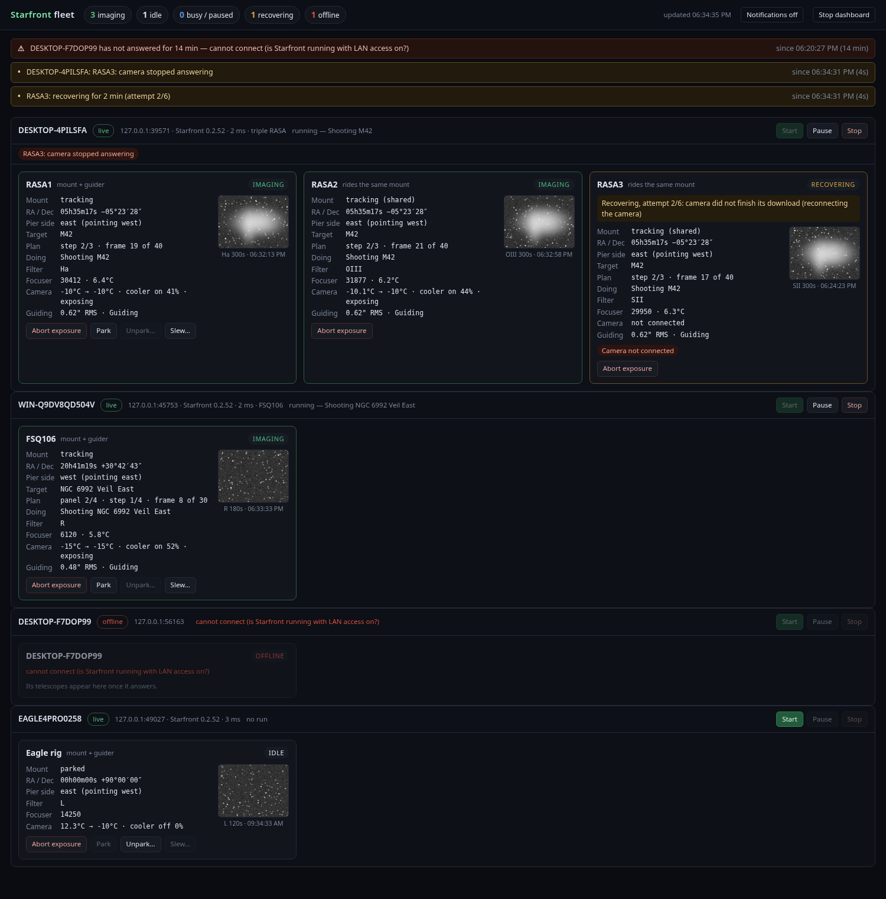

# Starfront 0.2.52: the fleet dashboard

One browser page that shows every Starfront PC and telescope at the
observatory and runs the basic controls. It runs on any one PC on the
observatory LAN, and you reach it over your VPN. It is for personal use, and
nothing is put on the public collab server.



`fleet-screenshot.png` is the real page in headless Chrome. It is fed by four
made-up PCs that answer exactly as Starfront does, using
`tools/fleet_demo.py --screenshot`:

- DESKTOP-4PILSFA: triple RASA imaging M42, with RASA3 recovering (attempt 2/6).
- WIN-Q9DV8QD504V: FSQ106 imaging panel 2/4 and guiding.
- DESKTOP-F7DOP99: switched off, raising an offline alert.
- EAGLE4PRO0258: parked and idle.

Source: `starfront-source-0.2.52.zip` (tag `v0.2.52`, on top of v0.2.51).

## 1. Turn on LAN access on each Starfront PC (once)

LAN access is **off by default**. When it is off, Starfront behaves exactly
as before: it is reachable only from the PC itself, and requests from
anywhere else are refused.

When you turn it on, three things change:
- Starfront also listens on the LAN, on port **8765** (`server.lanPort`).
- Every request that does not come from the PC itself must carry the fleet
  token. Without it the request is refused with 403. This covers the page,
  the API and the websocket.
- On the PC itself nothing changes.

To turn it on, run this in PowerShell on the PC, with Starfront running:

```powershell
$port = Get-Content "$HOME\Starfront\server.port"      # or $HOME\AstroControl\server.port
Invoke-RestMethod -Method Post -Uri "http://127.0.0.1:$port/api/settings/server" `
  -ContentType 'application/json' `
  -Body '{"lanAccess": true, "fleetToken": "PASTE-ONE-LONG-SECRET-HERE"}'
```

Use the same token on every PC: one long random string of at least 16
characters. To have one generated instead, send `{"lanAccess": true}`. The
answer then shows the token, and you can read it again later with
`GET /api/settings/server` from that PC. Other settings keys:
- `nodeName`: the name shown on the dashboard.
- `lanPort`: the port to listen on.
- `{"regenerateToken": true}`: makes a new token.

You can also close Starfront and edit `settings.json` in the same data
folder:

```json
"server": {"lanAccess": true, "lanPort": 8765, "fleetToken": "PASTE-ONE-LONG-SECRET-HERE", "nodeName": ""}
```

**Restart Starfront** afterwards, because the listening address changes only
at start-up. The token check applies at once.

Windows Firewall will ask the first time Starfront listens on the LAN. Allow
it on **Private** networks only. Starting Starfront with an explicit
`--host 0.0.0.0` (the old tablet mode) still opens it without a token, as
before.

## 2. fleet.json on the PC that runs the dashboard

The first run writes an example to `<data folder>\fleet.json`, for example
`C:\Users\<you>\Starfront\fleet.json`. Edit it:

```json
{
  "listen": {"host": "127.0.0.1", "port": 8790},
  "token": "PASTE-ONE-LONG-SECRET-HERE",
  "dashboardToken": "",
  "pollSeconds": 2, "timeoutSeconds": 3,
  "staleSeconds": 10, "offlineSeconds": 30,
  "offlineAlertMinutes": 5, "recoveringAlertMinutes": 10,
  "nodes": [
    {"name": "DESKTOP-4PILSFA", "host": "DESKTOP-4PILSFA", "port": 8765, "note": "triple RASA"},
    {"name": "WIN-Q9DV8QD504V", "host": "WIN-Q9DV8QD504V", "port": 8765, "note": "FSQ106"},
    {"name": "DESKTOP-F7DOP99", "host": "DESKTOP-F7DOP99", "port": 8765},
    {"name": "EAGLE4PRO0258",   "host": "EAGLE4PRO0258",   "port": 8765}
  ]
}
```

- **`host`**: a PC name, or its LAN IP if names do not resolve over the VPN.
  A fixed IP (a DHCP reservation) is the most reliable choice.
- **`port`**: 8765 if LAN access is on and that port was free. Otherwise
  use the number in that PC's `server.port` file.
- **`token`**: the fleet token. A node can carry its own `"token"` if you
  gave one PC a different one.
- **Telescopes**: you do not list them. Each PC reports its own, so the
  rigs on DESKTOP-F7DOP99 and EAGLE4PRO0258 appear as soon as those PCs
  answer.
- **`listen.host`**:
  - `127.0.0.1`: the page opens only on the PC running the dashboard.
  - `0.0.0.0`: the page can be opened from your laptop over the VPN, at
    `http://<that PC>:8790/`. Then also set **`dashboardToken`**. The page
    asks for it once and keeps it in that browser. Opening
    `http://<pc>:8790/?token=<dashboardToken>` also works.

## 3. Run it

Any one of these works:

- `Starfront.exe --fleet` opens the page in the browser. It has no window;
  the **Stop dashboard** button on the page ends it.
- `"Starfront Console.exe" --fleet` does the same with a console, which you
  can close to stop it.
- `python -m astrocontrol.fleet [--config path\fleet.json] [--port 8790] [--browser]`
  from source.
- Add `--fleet-config path\fleet.json` to either exe to use a fleet.json
  somewhere else.

The dashboard ships in the same exe. The PyInstaller spec already collects
`astrocontrol.*` and `astrocontrol/web`, so no packaging change was needed.
It can run on one of the telescope PCs or on any other PC on the LAN.

## What the page does

- **Summary bar**: counts of telescopes imaging, idle, busy or paused,
  recovering, and offline.
- **Freshness**: one section per PC, marked live, stale Ns or offline, with
  the reason (cannot connect / no answer in time / wrong token). It also
  shows the Starfront version and the round-trip time.
- **Rig cards**, one per telescope, showing:
  - mount: tracking, slewing, parked or stopped, with RA/Dec and pier side
    (followers say "shared");
  - target, plan step, panel, and frame n of m;
  - filter, focuser position and temperature;
  - camera temperature, setpoint, cooler on/off and power;
  - guiding RMS in arcsec;
  - last frame thumbnail with its filter, exposure and time;
  - recovery state, attempt n/m, reason and step, from 0.2.51;
  - warnings for that telescope, with the PC's own warnings board shown on
    the PC header.
- **Controls**:
  - Per PC: run Start / Pause or Resume / Stop. The run is per PC and covers
    all of its telescopes. Stop asks first.
  - Per telescope: Abort exposure.
  - On the mount's own card: Park, Unpark… and Slew…. **Unpark and slew ask
    for confirmation, and the dashboard refuses them without
    `confirm: true`.**
  - Each command shows *sending → pending → done / failed*. A slow command
    such as a park is followed through the PC's own background-command
    status from 0.2.50.
- **Alerts**: a PC offline for more than `offlineAlertMinutes`, a stalled
  run (the 0.2.51 watchdog), a run that ended with an error, a recovery that
  failed, a recovery running longer than `recoveringAlertMinutes`, and
  critical warnings. **Notifications** turns on browser notifications for
  new alerts.
- **Robustness**: every PC is polled on its own thread with a timeout, so a
  dead or hanging PC only marks its own section offline. The dashboard holds
  nothing that matters. Restart it whenever you like; the telescopes are not
  touched.

## Security notes

- The fleet token protects everything about a PC from the LAN, including
  the websocket. It is compared in constant time and masked as `***` in
  `/api/settings`. Treat it like a password and keep it off public places.
- Traffic is plain HTTP inside your LAN/VPN. Do not port-forward 8765 or
  8790 to the internet.
- With LAN access off, nothing changes from 0.2.51. The PC refuses LAN
  requests even with the token.

## Tests

`tools/check_fleet.py` passes 48/48. It runs:
- two real Starfront servers on fake devices, as separate processes: a
  triple, and a single with a slow mount;
- a PC that accepts connections and never answers;
- a PC that is switched off;
- the fleet dashboard reaching them over the box's LAN address, not
  loopback.

It covers:
- **Token**: refused without it, wrong token, right token, the PC itself
  without it, LAN commands, the websocket with and without it, LAN access
  off, and the token hidden in /api/settings.
- **Aggregation and summary**: correct cards and counts.
- **Freshness**: a PC frozen with SIGSTOP goes live → stale → offline →
  live.
- **Isolation**: the page stays under 0.5 s and A keeps being polled while
  C hangs.
- **Routing**:
  - abort on A/RASA2 stops only RASA2;
  - park on B goes pending → done while A is untouched;
  - a confirmed slew moves only B;
  - commands to the off PC fail with a reason;
  - a command to the hanging PC does not hold the page.
- **Rules**: unpark and slew are refused without confirm; offline, stalled
  and recovery-failed alerts; the dashboard token.
- **The page in jsdom**: cards, summary, offline cards and alerts, the
  confirm dialog (No sends nothing; Yes sends and follows the command to
  done).

The full existing suite gives the same results as 0.2.51: every check matches, including the failures that were already there (check_controls 2, check_imagestack exit 1, check_livestack 1, check_reference 2, and check_night_rollover 2, which depends on the time of day).

## Not tested yet (needs the real LAN)

- Name resolution and the Windows Firewall prompt on the real PCs over the
  VPN.
- Card fields from real drivers: the fakes report fewer fields, and the
  canned demo uses the ASCOM and PHD2 field names. Check pier side, cooler
  power and guiding RMS on the first night.
- Thumbnails of full-size frames over the VPN. They are rendered on the PC
  at 360 px and cached by the dashboard.
